<h1 align="center">Clinical Scribe — Privacy-Preserving AI Scribe & Diagnostic Copilot</h1>

<p align="center">
  <b>Listens locally. Drafts with evidence. Gates every claim. The clinician signs. Patient data never leaves the machine.</b>
</p>

<p align="center">
  
  
  
  
  
  
  
</p>
<p align="center">
  
  
  
  
  
  
  
</p>

---

## Table of Contents

- [Core Concept](#core-concept)
- [Non-Negotiable Safety Principles](#non-negotiable-safety-principles)
- [Architecture](#architecture)
- [Encounter Lifecycle](#encounter-lifecycle)
- [Live Audio Pipeline](#live-audio-pipeline)
- [Two-Phase Note Generation](#two-phase-note-generation)
- [Safety Layer](#safety-layer)
- [Clinician Review & Sign-off](#clinician-review--sign-off)
- [EHR Integration (FHIR)](#ehr-integration-fhir)
- [Data Model & Auditability](#data-model--auditability)
- [Privacy & Security Controls](#privacy--security-controls)
- [Testing & Evaluation](#testing--evaluation)
- [Architecture Decision Records](#architecture-decision-records)
- [Repository Structure](#repository-structure)
- [Getting Started](#getting-started)
- [API Reference](#api-reference)
- [Contributing](#contributing)

---

## Core Concept

Clinical Scribe turns a recorded doctor–patient consultation into a **structured SOAP note** and a **draft prescription**. Every statement cites the transcript segments it came from. A deterministic safety layer checks every claim, and nothing is final until a clinician reviews and signs it.

The AI only **drafts**. Deterministic code does the **gating**. The clinician **decides**.

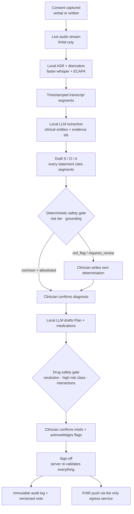

---

## Non-Negotiable Safety Principles

These rules come from [`AGENTS.md`](AGENTS.md) and the ADRs. They take priority over convenience and performance.

| Principle | How it is enforced |
|---|---|
| **No patient data leaves the machine** | Every clinical service runs on an `internal: true` Docker network with no route out. No hosted AI, speech, or telemetry SDKs (`tests/security/test_no_cloud_deps.py`). |
| **Audio is never persisted** | Audio stays in RAM buffers only. Redis runs with `--save "" --appendonly no`. The prod ASR container is `read_only` with a `noexec` tmpfs. |
| **No invented clinical content** | Every AI statement needs a non-empty `evidence` array of real transcript segment ids. Invalid citations trigger a regeneration and are marked `ungrounded`. |
| **Drug interactions are not an LLM task** | Interactions come from a lookup in a local, cited table. Rows without a `source_ref` are dropped at load time. |
| **No "approve all" action** | Each flagged statement and medication needs its own clinician action. The server re-checks everything at sign-off. |
| **No external terminology services** | Ingredient normalisation uses a local dictionary plus fuzzy matching only. No RxNav or UMLS calls at runtime (ADR-0004). |
| **Logs never contain clinical text** | Services log structure (counts, ids) and not content. `REDACT_CLINICAL_TEXT_IN_LOGS=true` is enforced by a CI test. |

---

## Architecture

The system is a set of small FastAPI microservices behind one orchestrating **gateway**. Two Docker networks split the system into an isolated clinical zone and an edge zone.

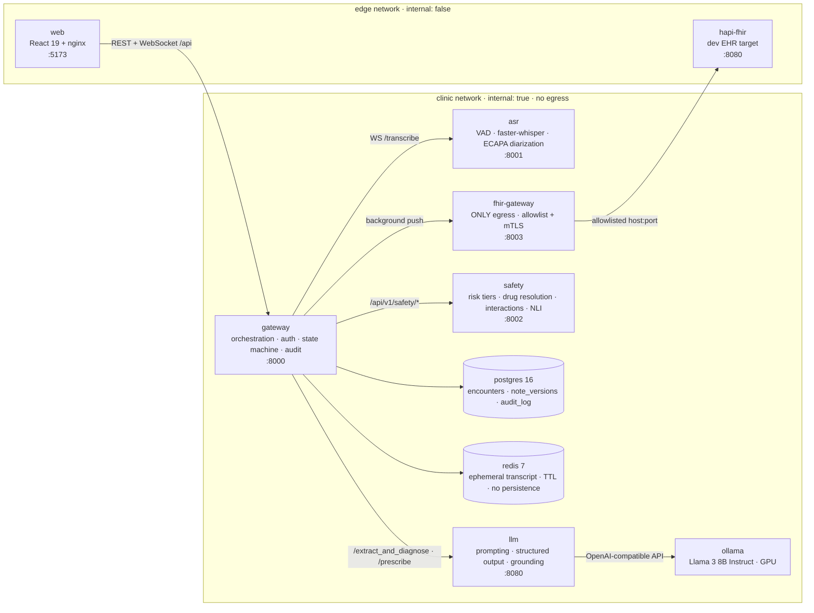

| Service | Port | Responsibility |
|---|---|---|
| `gateway` | 8000 | Public API, JWT + CSRF auth, Postgres RLS identity, encounter state machine, LLM/safety orchestration, audit logging, WebSocket relay to ASR |
| `asr` | 8001 | Streaming speech-to-text: Silero VAD, utterance segmentation, faster-whisper (int8, CPU), ECAPA-TDNN speaker diarization |
| `llm` | 8080 | Jinja2 prompt templates, JSON-schema structured output, evidence-id validation with retry, model fallback |
| `ollama` | 11434 | Local LLM runtime (OpenAI-compatible endpoint), GPU-reserved |
| `safety` | 8002 | Deterministic diagnosis risk tiers, medication resolution, high-risk class detection, interaction lookup, DeBERTa NLI grounding check |
| `fhir-gateway` | 8003 | Builds and validates a FHIR transaction Bundle and pushes it **only** to the allowlisted EHR host |
| `postgres` | 5432 | System of record: encounters, versioned notes, append-only audit log, users/roles |
| `redis` | 6379 | Short-lived transcript, entities, and id-map cache (TTL, persistence disabled) |
| `web` | 5173 | Clinician UI: consent gate, live transcript, staged SOAP review, audit dashboard |

---

## Encounter Lifecycle

Each encounter moves through a strict, audited state machine. Every transition writes a `state_change` row to the append-only audit log.

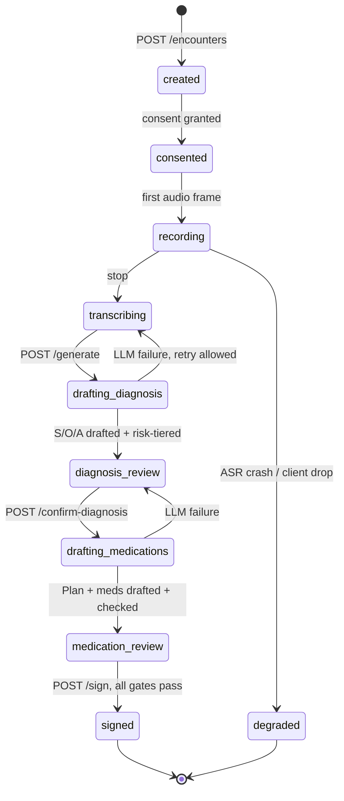

| Consent state | Effect |
|---|---|
| `pending` | Audio frames are rejected by the gateway |
| `granted` / `granted_verbal_witnessed` | Recording allowed; consent and timestamp are audited |
| `declined` | Recording never starts |

---

## Live Audio Pipeline

The browser captures microphone audio as 16 kHz, 16-bit mono PCM and streams binary frames over a WebSocket. The gateway checks auth and consent before it forwards any audio to the ASR service.

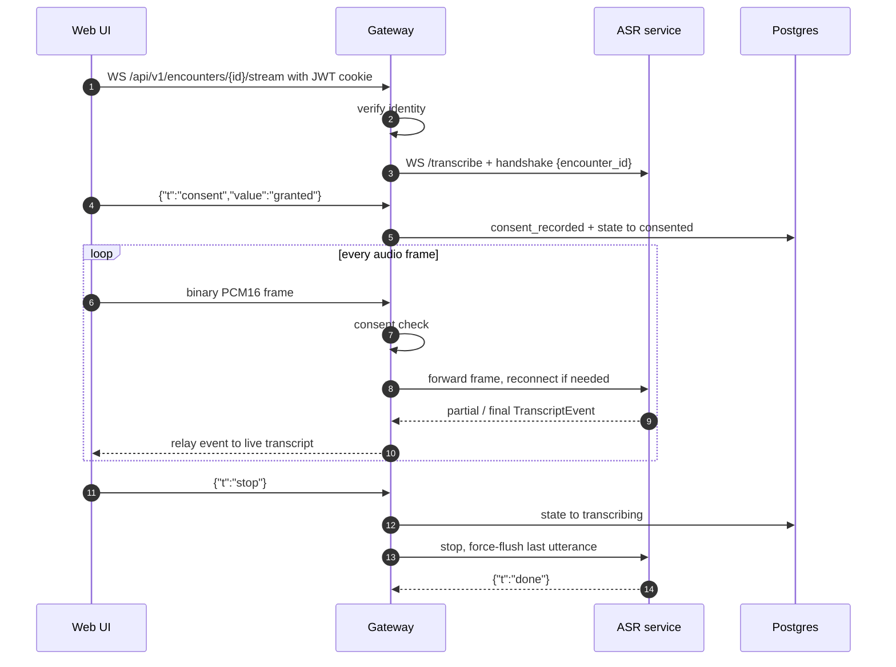

Inside the ASR service, each utterance goes through transcription and diarization **in parallel**:

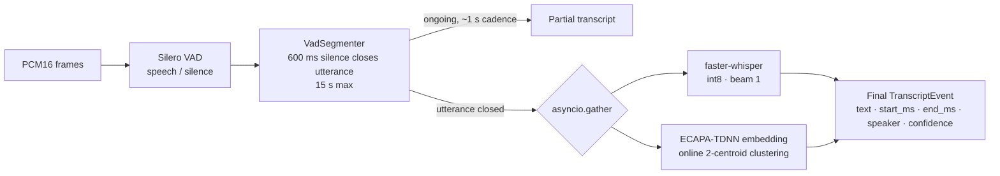

- **Models are pre-warmed** at startup (Silero VAD and the SpeechBrain ECAPA classifier are cached singletons), so the WebSocket handshake isn't delayed by model loading.
- **Timestamps** come from VAD-detected utterance boundaries. Segments with `end_ms <= start_ms` are dropped.
- **Speakers** `spk_a` / `spk_b` are relabelled to `clinician` / `patient` before the transcript reaches the LLM.

---

## Two-Phase Note Generation

Note generation is split into two clinician-gated phases. The LLM never drafts a prescription until a clinician has confirmed the diagnosis.

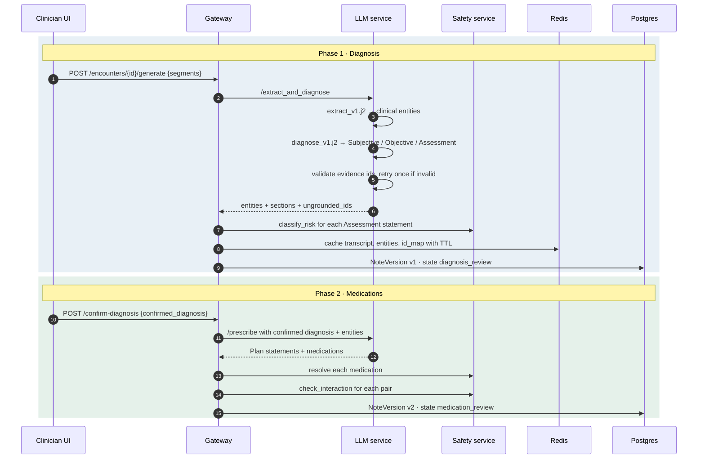

### Prompt design

| Template | Purpose | Key rules |
|---|---|---|
| [`extract_v1.j2`](services/llm/prompts/extract_v1.j2) | Entity extraction | Categories: `symptom_active`, `symptom_denied`, `medication`, `diagnosis`, `plan`, `vital`, `other`. Each entity needs at least one `evidence_span_id`. |
| [`diagnose_v1.j2`](services/llm/prompts/diagnose_v1.j2) | S / O / A drafting | Concise clinical shorthand, no first-person quotes. Patient-reported history goes in **Subjective**; only measurable findings go in **Objective**. Diagnoses should use canonical terminology. |
| [`prescribe_v1.j2`](services/llm/prompts/prescribe_v1.j2) | Plan + medications | Conditioned on the clinician-confirmed diagnosis only |

The LLM runs at `temperature: 0.0` with strict `json_schema` response formatting generated from the shared Pydantic contracts in [`packages/contracts`](packages/contracts/soap_note.schema.json).

---

## Safety Layer

The `safety` service is **fully deterministic**: CSV dictionaries, fuzzy string matching, and one local NLI model. It never calls an LLM (`tests/safety/test_no_llm.py`).

### Diagnosis risk classification

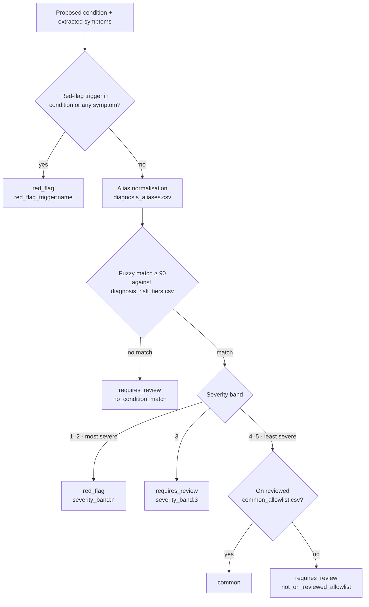

The gate **fails closed**: any diagnosis it can't confidently match (for example, a colloquial term like *"severe cold"*) becomes `requires_review`, and the clinician must write their own determination.

### Medication resolution & interactions

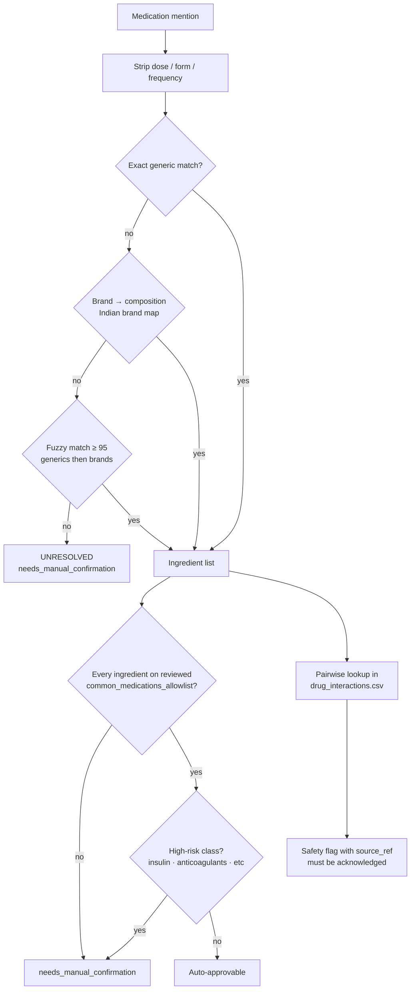

### Local knowledge base

| File | Rows | Purpose |
|---|---:|---|
| [`drug_interactions.csv`](services/safety/data/drug_interactions.csv) | 1,150 | Cited pairwise interactions (every row has a `source_ref`) |
| [`high_risk_classes.csv`](services/safety/data/high_risk_classes.csv) | 92 | Drugs that always need manual confirmation |
| [`diagnosis_risk_tiers.csv`](services/safety/data/diagnosis_risk_tiers.csv) | 49 | Canonical condition names with severity bands (from DDXPlus) |
| [`common_medications_allowlist.csv`](services/safety/data/common_medications_allowlist.csv) | 16 | Clinician-reviewed low-risk ingredients |
| [`common_allowlist.csv`](services/safety/data/common_allowlist.csv) | 15 | Clinician-reviewed low-risk conditions |
| [`red_flag_triggers.csv`](services/safety/data/red_flag_triggers.csv) | 11 | Symptoms that always escalate |
| [`diagnosis_aliases.csv`](services/safety/data/diagnosis_aliases.csv) | — | Colloquial → canonical name mapping |

Data provenance is documented in [`services/safety/data/SOURCES.md`](services/safety/data/SOURCES.md).

### Grounding

Two layers of grounding protect against hallucination:

1. **Structural** (LLM service): every cited evidence id must exist in the transcript. If any are invalid, the note is regenerated once. Statements that still fail are listed in `grounding.ungrounded_ids`.
2. **Semantic** (safety service): `cross-encoder/nli-deberta-v3-small` checks that the cited transcript text *entails* the statement. Contradiction **and** neutral both count as ungrounded.

---

## Clinician Review & Sign-off

The review UI shows each statement with its evidence (click to expand the cited transcript spans), its risk tier, and any safety flags. Signing is disabled until every blocking item is resolved. The **server re-validates everything** at `POST /sign`, so the UI is never the only gate.

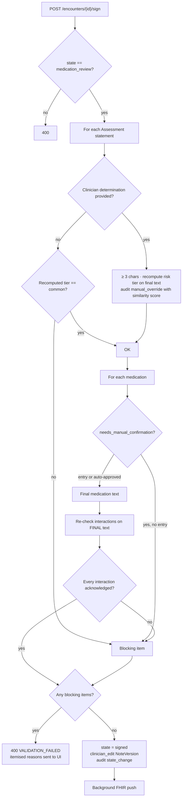

- If the safety service is unreachable during sign-off, the gateway returns **503** and does not sign.
- Signed notes are never edited in place. Admins can only append a reasoned **addendum**, which creates a new `admin_correction` version.

---

## EHR Integration (FHIR)

`fhir-gateway` is the **only** component allowed to reach outside the clinical network.

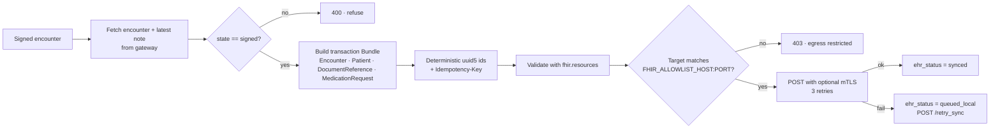

`DocumentReference` resources carry provenance meta tags (`statement-type`, `risk-tier`). Medications that needed manual entry are annotated in the `MedicationRequest`.

---

## Data Model & Auditability

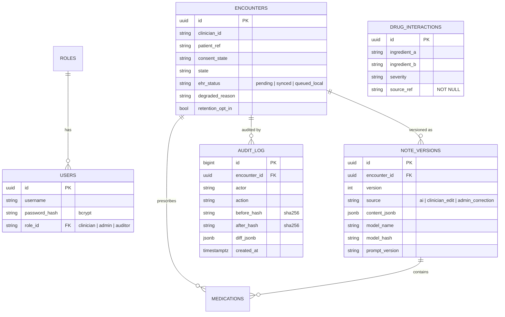

**Audit guarantees**

- `audit_log` is **append-only at the database level**: the `scribe_app` role has `INSERT, SELECT` only, and `UPDATE, DELETE` are revoked. Migrations run as the Postgres superuser so these revokes actually apply to the app role (`tests/security/test_audit_immutable.py`).
- Every row stores SHA-256 hashes of the before/after state plus a JSON diff.
- `manual_override` rows record the AI text, the clinician text, the recomputed risk tier, and an `ai_similarity_score` / `matches_ai_draft` flag. This makes rubber-stamping visible.
- Every note version records `model_name`, `model_hash`, and `prompt_version`, so you can always answer *"what did the AI originally draft, and with which model?"*

**Retention tiers** (ADR-0002)

| Tier | Data | Retention |
|---|---|---|
| 1 | Audio | **Never** written to disk, in any configuration |
| 2 | Transcript | Redis with TTL (`TRANSCRIPT_TTL_SECONDS`); persistent only on per-encounter opt-in |
| 3 | Note versions + audit log | Permanent: diffs of clinical text, never audio |

---

## Privacy & Security Controls

| Control | Implementation |
|---|---|
| Network isolation | `clinic` network is `internal: true`; only `gateway` and `fhir-gateway` also join `edge` |
| Offline models | `HF_HUB_OFFLINE=1` / `TRANSFORMERS_OFFLINE=1` everywhere; model weights fetched at build time only (ADR-0015) |
| Authentication | bcrypt password hashes, HS256 JWT in an `httponly` cookie, 12 h expiry; startup refuses `JWT_SECRET` under 32 bytes |
| CSRF | Double-submit cookie: `csrf_token` cookie must match the `x-csrf-token` header on every mutating request |
| Row-Level Security | Each DB session sets `app.current_user_id` / `app.current_role_id` from the **verified JWT** and then `SET ROLE scribe_app`. Roles cannot be self-asserted. |
| Role separation | `clinician` drafts and signs · `admin` appends addenda · `auditor` reads audit trails |
| Least privilege DB | App role cannot mutate audit rows; migrations run as superuser |
| Hardened prod overlay | `docker-compose.prod.yml`: read-only ASR filesystem, `noexec` tmpfs, memory limits, log rotation |
| Egress verification | `make verify-offline` runs the egress test suite with `--network none` |

---

## Testing & Evaluation

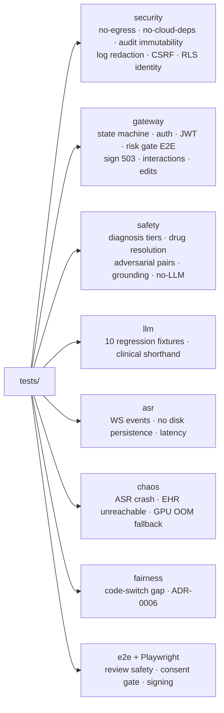

| Command | What it does |
|---|---|
| `make test` | Full pytest suite inside the gateway container + web tests |
| `make verify-offline` | Proves zero outbound egress except the FHIR allowlist |
| `make eval DATASET=...` | Runs the evaluation harness |
| `make contracts` | Regenerates Python + TS types from `soap_note.schema.json` |
| `npm run test:e2e` (in `apps/web`) | Playwright UI safety tests |

**Evaluation harness** ([`eval/harness/run.py`](eval/harness/run.py)) reports measured metrics, not quoted industry averages (ADR-0007, ADR-0008):

| Metric | Description |
|---|---|
| WER / CER | ASR accuracy against reference transcripts (`jiwer`) |
| Medication P / R / F1 / exact match | Prescription extraction accuracy |
| Unsupported-claim rate | Per SOAP section: the hallucination measure |
| Omission rate | Clinically relevant content missed |
| Risk-escalation agreement | Safety tier vs reference |
| Latency | Per pipeline stage |
| Energy per consultation | GPU power sampled via `nvidia-smi` |
| Diarization accuracy | [`run_diarization_eval.py`](eval/harness/run_diarization_eval.py) |

---

## Architecture Decision Records

| ADR | Decision |
|---|---|
| [0001](docs/decisions/0001-egress-policy.md) | Egress policy: "egress-denied, LAN-isolated", not "air-gapped" |
| [0002](docs/decisions/0002-retention-tiers.md) | Three-tier data retention |
| [0003](docs/decisions/0003-diagnostic-copilot-scope.md) | "Diagnostic copilot" re-scoped to non-autonomous decision support |
| [0004](docs/decisions/0004-drug-data-sources.md) | Drug interaction and ingredient data sources (local only) |
| [0005](docs/decisions/0005-model-choice-llama3-8b.md) | Fixed model: Llama 3 8B Instruct |
| [0006](docs/decisions/0006-hinglish-evaluation.md) | Mandatory Hindi–English code-switching evaluation subset |
| [0007](docs/decisions/0007-hallucination-definition.md) | Hallucination is measured, not quoted |
| [0008](docs/decisions/0008-energy-measurement-method.md) | Energy-per-consultation is measured |
| [0009](docs/decisions/0009-form-numbering-fix.md) | Form numbering fix |
| [0013](docs/decisions/0013-speaker-diarization.md) | Speaker diarization strategy |
| [0015](docs/decisions/0015-speaker-embedding-build-time-downloads.md) | Build-time model downloads are not runtime egress |

> ADRs and `eval/datasets/` are **human-owned**. Changes to `packages/contracts/` need an explicit, ADR-backed instruction.

---

## Repository Structure

```text
clinical-scribe/
├── apps/
│   └── web/                     # React 19 + Vite + Tailwind clinician UI
│       ├── src/pages/           # Start · Consultation · Review · AuditDashboard · EncounterAuditDetail
│       ├── src/components/      # consultation/ (consent, recorder, live transcript) · review/ (SOAP, evidence, sign)
│       ├── src/hooks/           # useAudioCapture · useWebSocket · useTranscript · useReviewState
│       ├── e2e/ · tests/        # Playwright safety + review specs
│       └── nginx.conf           # Serves SPA, proxies /api (REST + WS) to gateway
├── services/
│   ├── gateway/                 # Orchestrator: auth, RLS, state machine, audit, WS relay
│   │   └── alembic/versions/    # Schema, RLS policies, seed users, ehr_status
│   ├── asr/                     # VAD + faster-whisper + ECAPA diarization
│   ├── llm/                     # Prompt templates (prompts/*.j2) + structured generation
│   ├── safety/                  # Deterministic risk/drug/interaction/grounding checks
│   │   └── data/                # Local, cited CSV knowledge base
│   └── fhir-gateway/            # Sole egress point → FHIR Bundle push
├── packages/
│   └── contracts/               # soap_note.schema.json → generated Pydantic + TS types
├── tests/                       # security · gateway · safety · llm · asr · chaos · fairness · e2e
├── eval/
│   ├── harness/                 # Metrics harness (WER, hallucination, energy, diarization)
│   └── datasets/                # Human-owned evaluation data (do not edit)
├── scripts/                     # Model download, data seeding, dev DB reset, eval helpers
├── infra/                       # DB init, firewall, observability, secrets placeholders
├── docs/
│   ├── architecture.md
│   └── decisions/               # ADRs (human-owned)
├── docker-compose.yml           # Dev stack
├── docker-compose.prod.yml      # Hardened production overlay
├── Makefile
└── AGENTS.md                    # Standing rules for coding agents
```

---

## Getting Started

### Prerequisites

- Docker + Docker Compose
- NVIDIA GPU + NVIDIA Container Toolkit (for the `ollama` service)
- Python 3.12 with `huggingface_hub` (one-time model download only)
- ~20 GB free disk for images and model weights

### 1. Configure environment

```bash
cp .env.example .env
```

Edit `.env` and set at least:

```ini
JWT_SECRET=<at least 32 random bytes>   # python -c "import secrets; print(secrets.token_urlsafe(48))"
POSTGRES_SUPERUSER_PASSWORD=<secret>
POSTGRES_PASSWORD=<secret>
LLM_BACKEND=http://ollama:11434/v1/chat/completions
LLM_MODEL_NAME=llama3.1:latest
```

> [!IMPORTANT]
> `LLM_BACKEND` must be the full OpenAI-compatible chat-completions URL. The LLM service rejects values that don't start with `http`.

### 2. Fetch build-time models (one-time, needs internet)

Per ADR-0015, these are downloaded on the host **before** the build and baked into images. They are never fetched at runtime.

```bash
pip install huggingface_hub
python scripts/download_ecapa.py      # → services/asr/models/spkrec-ecapa-voxceleb
python scripts/download_deberta.py    # → services/safety/models/nli-deberta-v3-small
```

### 3. Provision the LLM weights (one-time)

`ollama` sits on the egress-denied `clinic` network, so it **cannot** pull models itself. Seed its volume from a temporary container instead:

```bash
docker volume create clinical-scribe_ollama_data
docker run -d --name ollama-seed -v clinical-scribe_ollama_data:/root/.ollama ollama/ollama
docker exec ollama-seed ollama pull llama3.1
docker rm -f ollama-seed
```

### 4. Build and start the stack

```bash
docker compose up --build -d
```

### 5. Run migrations (creates schema, audit permissions, RLS, seed users)

```bash
docker compose exec -e POSTGRES_SUPERUSER=postgres \
  -e POSTGRES_SUPERUSER_PASSWORD=<your superuser password> \
  gateway alembic -c /app/alembic.ini upgrade head
```

On Windows you can instead run the dev-only reset script, which wipes **only** the Postgres volume and re-migrates:

```powershell
./scripts/reset_dev_db.ps1
```

### 6. Open the app

| URL | What |
|---|---|
| http://localhost:5173 | Clinician UI |
| http://localhost:8000/docs | Gateway OpenAPI docs |

Seeded dev accounts (passwords come from `.env`):

| Username | Role | Password variable |
|---|---|---|
| `dr-martinez` | clinician | `SEED_CLINICIAN_PASSWORD` |
| `dr-jones` | clinician (RLS test user) | `SEED_CLINICIAN_PASSWORD` |
| `admin` | admin | `SEED_ADMIN_PASSWORD` |
| `auditor` | auditor | `SEED_ADMIN_PASSWORD` |

> [!WARNING]
> Default seed passwords are for local development only. The migration prints a warning when they're used.

### Key configuration

| Variable | Default | Purpose |
|---|---|---|
| `WHISPER_MODEL` | `small` | `tiny` / `small` are baked into the ASR image |
| `UTTERANCE_SILENCE_MS` | `600` | Silence that closes an utterance |
| `TRANSCRIPT_TTL_SECONDS` | `3600` | Redis transcript lifetime |
| `FUZZY_MATCH_MIN_CONFIDENCE` | `0.72` | Drug-name fuzzy threshold |
| `FHIR_ALLOWLIST_HOST` / `_PORT` | — | The single permitted egress target |
| `FHIR_MTLS_CERT_PATH` / `_KEY_PATH` | — | Client certs for the EHR push |
| `LLM_FALLBACK_BACKEND` / `_MODEL` | — | Smaller-tier fallback on LLM failure |
| `AUDIO_RETENTION` | `never` | Must always be `never` |
| `REDACT_CLINICAL_TEXT_IN_LOGS` | `true` | Must always be `true` |

---

## API Reference

All gateway routes are under `/api/v1`. Mutating requests need the JWT cookie **and** a matching `x-csrf-token` header.

| Method | Route | Description |
|---|---|---|
| `POST` | `/auth/login` | Issue JWT + CSRF cookies |
| `POST` | `/encounters` | Create encounter (`created`, consent `pending`) |
| `GET` | `/encounters` | List encounters (RLS-scoped) |
| `GET` | `/encounters/{id}` | Encounter, latest note, transcript |
| `WS` | `/encounters/{id}/stream` | Consent, audio frames, stop · live transcript events |
| `POST` | `/encounters/{id}/generate` | Phase 1: draft S / O / A |
| `POST` | `/encounters/{id}/confirm-diagnosis` | Phase 2: draft Plan + medications |
| `GET` / `PATCH` | `/encounters/{id}/note` | Read / edit latest note |
| `POST` | `/encounters/{id}/statements` | Add a clinician-entered statement |
| `POST` | `/encounters/{id}/acknowledge-flag` | Acknowledge a safety flag (audited) |
| `POST` | `/encounters/{id}/sign` | Validate all gates and sign |
| `POST` | `/encounters/{id}/retry_sync` | Retry a queued FHIR push |
| `POST` | `/encounters/{id}/addendum` | Admin-only reasoned correction |
| `GET` | `/encounters/{id}/audit` | Full audit trail |

**Internal service endpoints** (reachable only on the `clinic` network)

| Service | Route |
|---|---|
| asr | `WS /transcribe` |
| llm | `POST /extract_and_diagnose`, `POST /prescribe` |
| safety | `POST /api/v1/safety/classify_risk`, `/resolve`, `/check_interaction`, `/verify_grounding` |
| fhir-gateway | `POST /push` |

---

## Contributing

Read [`AGENTS.md`](AGENTS.md) before contributing. A change is **done** only when:

1. `mypy` / `tsc` pass and `ruff` / `eslint` are clean.
2. Unit tests are written and passing, plus an integration test if the change crosses a service boundary.
3. `make verify-offline` still passes.
4. UI changes are browser-verified, with a screenshot.
5. The change comes with a one-paragraph summary of what changed and why.

Never add hosted AI, speech, or telemetry dependencies. Never write audio to disk. Never log clinical text. Never add an "approve all" action. If a requirement is ambiguous, **stop and ask**: this is a safety-relevant medical system.

---

<p align="center"><sub>Built local-first. The AI drafts, deterministic code gates, the clinician decides.</sub></p>
