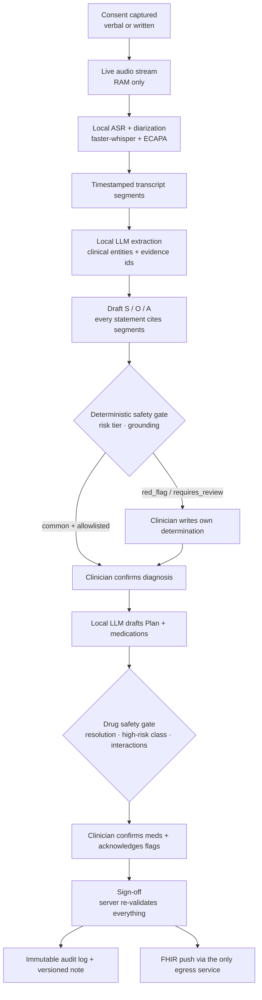
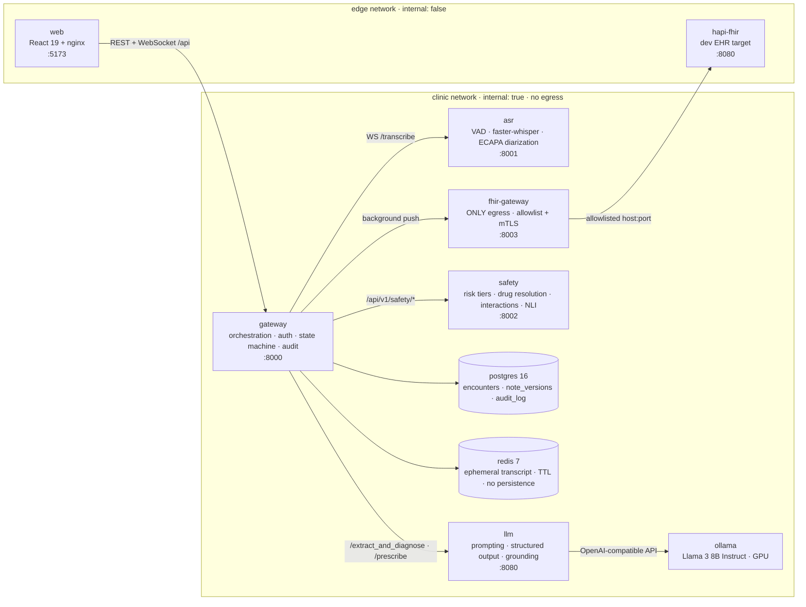
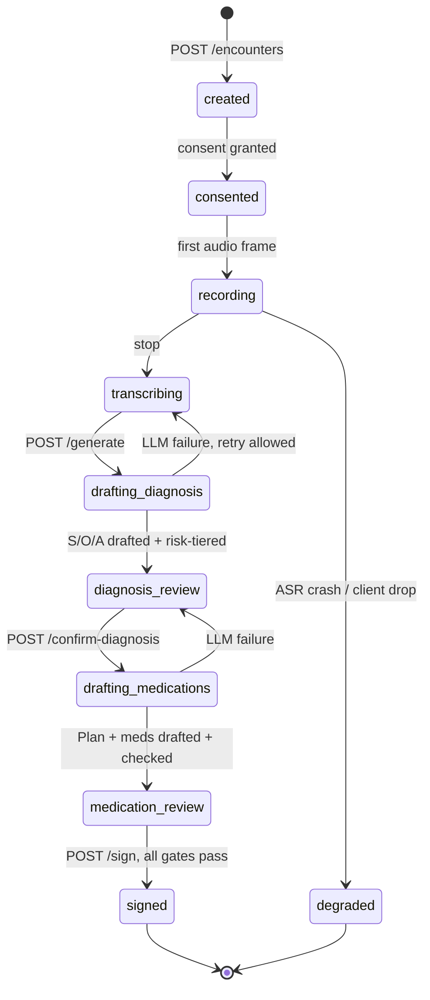
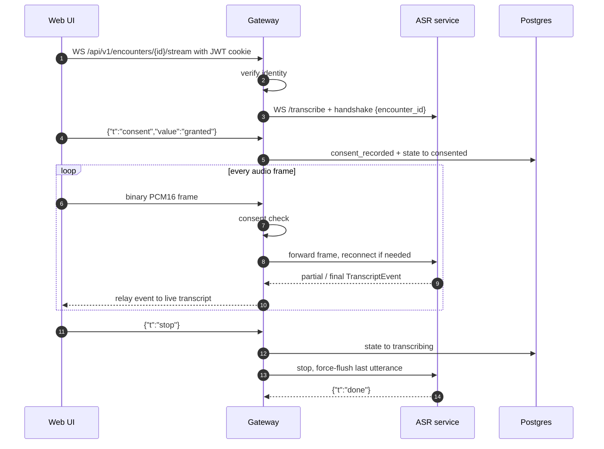
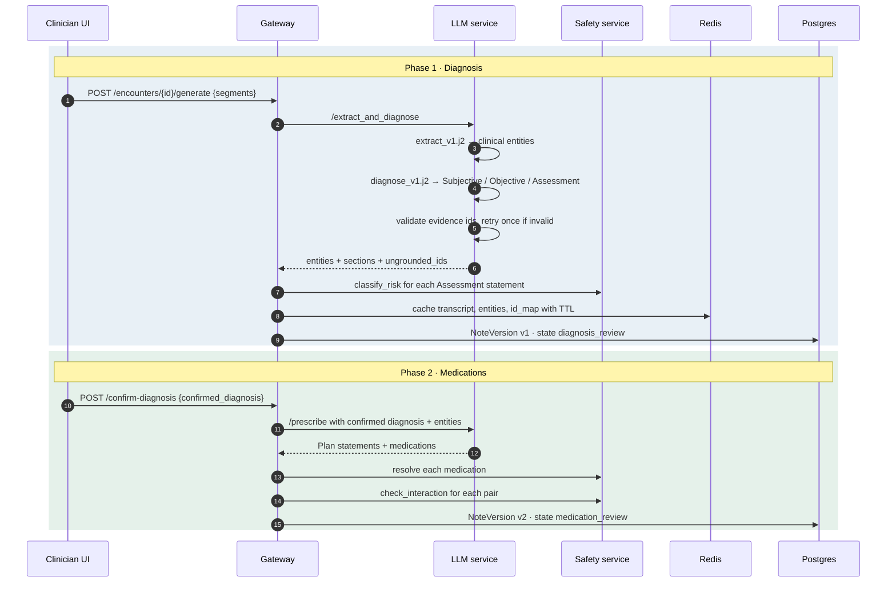
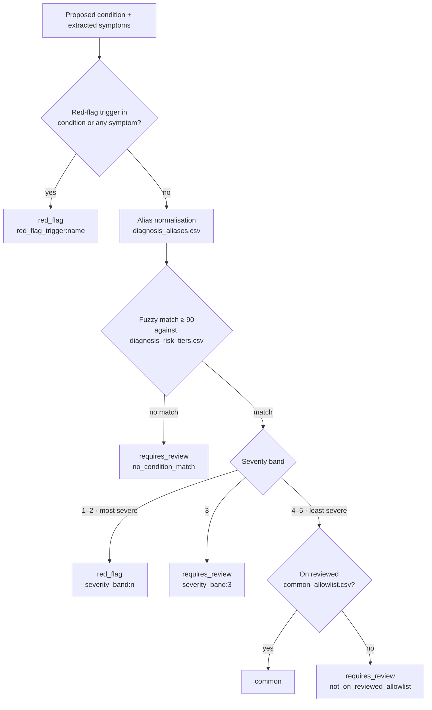
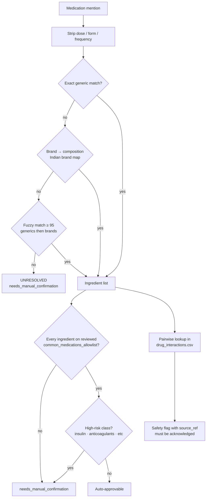
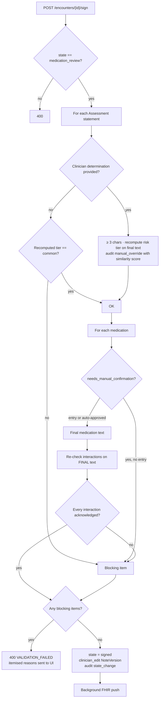
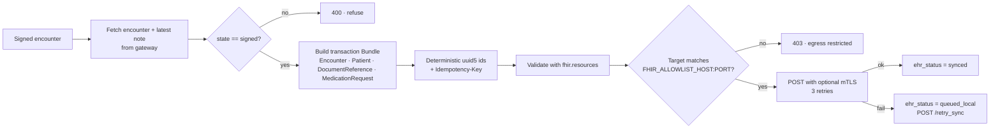

<h1 align="center">Clinical Scribe — Privacy-Preserving AI Scribe & Diagnostic Copilot</h1>

<p align="center">
  <b>Listens locally. Drafts with evidence. Gates every claim. The clinician signs. Patient data never leaves the machine.</b>
</p>

<p align="center">
  
  
  
  
  
  
  
</p>
<p align="center">
  
  
  
  
  
  
  
</p>

---

## Table of Contents

- [Core Concept](#core-concept)
- [Safety & Security Principles](#safety--security-principles)
- [Architecture](#architecture)
- [Encounter Lifecycle](#encounter-lifecycle)
- [Live Audio Pipeline](#live-audio-pipeline)
- [Two-Phase Note Generation](#two-phase-note-generation)
- [Safety Layer](#safety-layer)
- [Clinician Review & Sign-off](#clinician-review--sign-off)
- [EHR Integration (FHIR)](#ehr-integration-fhir)
- [Data Model & Auditability](#data-model--auditability)
- [Testing & Evaluation](#testing--evaluation)
- [Architecture Decision Records](#architecture-decision-records)
- [Repository Structure](#repository-structure)
- [Getting Started](#getting-started)
- [API & Documentation](#api--documentation)
- [Contributing](#contributing)

---

## Core Concept

Clinical Scribe turns a recorded doctor–patient consultation into a **structured SOAP note** and a **draft prescription**. Every statement cites the transcript segments it came from. A deterministic safety layer checks every claim, and nothing is final until a clinician reviews and signs it.

The AI only **drafts**. Deterministic code does the **gating**. The clinician **decides**.

<details>
<summary><b>View Flow Diagram: End-to-End Pipeline Overview</b></summary>



</details>

---

## Safety & Security Principles

These rules derive from [`AGENTS.md`](AGENTS.md) and authoritative project ADRs. They outrank convenience and performance:

| Principle | Enforcement Mechanism |
|---|---|
| **Zero data egress** | All clinical services live on an `internal: true` Docker bridge network with no default gateway. Banned SDKs (`openai`, `anthropic`, telemetry) are caught in CI by `tests/security/test_no_cloud_deps.py`. |
| **RAM-only audio** | Audio frames reside in transient memory buffers only. Redis runs with `--save "" --appendonly no`. The production ASR container runs `read_only` with `noexec` tmpfs. |
| **No ungrounded claims** | Generated statements must include a non-empty `evidence` list pointing to actual transcript segment IDs. Citing missing IDs triggers regeneration and marks items as `ungrounded`. |
| **Deterministic drug safety** | Drug interactions are direct lookups against a local, cited table (`services/safety/data/drug_interactions.csv`). LLMs are strictly forbidden from interaction checking. |
| **No auto-approval** | "Approve all" and "auto-sign" actions are prohibited in the UI and blocked at the API level. Each flagged condition and high-risk medication requires discrete clinician confirmation. |
| **Offline terminology** | Ingredient normalization is strictly local-dictionary + fuzzy matching. Runtime queries to RxNav, RxNorm, or UMLS are prohibited (ADR-0004). |
| **Log redaction** | Structured metadata (counts, IDs) is logged; raw transcripts, audio, and patient identifiers are never logged (`tests/security/test_log_redaction.py`). |
| **Authentication & CSRF** | Passwords hashed with bcrypt; HS256 JWT in `HttpOnly` cookies. Mutating requests enforce double-submit CSRF cookie checks (`tests/security/test_csrf_protection.py`). |
| **Row-Level Security (RLS)** | Database sessions bind `app.current_user_id` and `app.current_role_id` strictly from verified JWT tokens, preventing role spoofing (`tests/security/test_rls_uses_verified_identity.py`). |
| **Role separation** | Role-based capabilities: `clinician` records & signs; `admin` appends addenda; `auditor` inspects compliance logs. |
| **Hardened prod overlay** | `docker-compose.prod.yml` enforces container memory caps, read-only root filesystems, and strict firewall egress restrictions. |

---

## Architecture

The system consists of small FastAPI microservices coordinated through an orchestrating **gateway**. Docker networks isolate the clinical pipeline from the edge network.

<details>
<summary><b>View Architecture Diagram: Network & Service Topology</b></summary>



</details>

| Service | Port | Responsibility |
|---|---|---|
| `gateway` | 8000 | Public API, JWT + CSRF auth, Postgres RLS identity, encounter state machine, LLM/safety orchestration, audit logging, WebSocket relay to ASR |
| `asr` | 8001 | Streaming speech-to-text: Silero VAD, utterance segmentation, faster-whisper (int8, CPU), ECAPA-TDNN speaker diarization |
| `llm` | 8080 | Jinja2 prompt templates, JSON-schema structured output, evidence-id validation with retry, model fallback |
| `ollama` | 11434 | Local LLM runtime (OpenAI-compatible endpoint), GPU-reserved |
| `safety` | 8002 | Deterministic diagnosis risk tiers, medication resolution, high-risk class detection, interaction lookup, DeBERTa NLI grounding check |
| `fhir-gateway` | 8003 | Builds and validates a FHIR transaction Bundle and pushes it **only** to the allowlisted EHR host |
| `postgres` | 5432 | System of record: encounters, versioned notes, append-only audit log, users/roles |
| `redis` | 6379 | Short-lived transcript, entities, and id-map cache (TTL, persistence disabled) |
| `web` | 5173 | Clinician UI: consent gate, live transcript, staged SOAP review, audit dashboard |

---

## Encounter Lifecycle

Each encounter moves through a strict, audited state machine. Every transition writes a `state_change` row to the append-only audit log.

<details>
<summary><b>View State Machine Diagram: Encounter Lifecycle</b></summary>



</details>

- **Consent Enforcement**: The gateway rejects binary audio packets if consent is `pending` or `declined`. Recording begins only when `consent_state` is `granted` or `granted_verbal_witnessed`.

---

## Live Audio Pipeline

The browser captures microphone audio as 16 kHz, 16-bit mono PCM and streams binary frames over a WebSocket. The gateway validates authentication and consent before forwarding frames to the ASR service.

<details>
<summary><b>View Sequence Diagram: WebSocket Audio Streaming & VAD</b></summary>



</details>

- **ASR & Diarization**: Utterance boundaries are segmented via Silero VAD (600 ms silence timeout). Transcription (`faster-whisper` int8) and speaker embedding extraction (`speechbrain/spkrec-ecapa-voxceleb`) run concurrently via `asyncio.gather`.
- **Pre-warmed Models**: Silero and SpeechBrain models are loaded during ASR container initialization, preventing handshake latency spikes.

---

## Two-Phase Note Generation

Generation is separated into two clinician-gated phases. The LLM never drafts a prescription until the clinician has reviewed and confirmed the diagnosis.

<details>
<summary><b>View Sequence Diagram: Two-Phase Gated Note Generation</b></summary>



</details>

Prompts are managed as Jinja2 templates under [`services/llm/prompts/`](services/llm/prompts/) (`extract_v1.j2` for entity extraction, `diagnose_v1.j2` for concise clinical shorthand with strict Subjective/Objective boundaries, and `prescribe_v1.j2` for Plan and medication recommendations conditioned solely on the clinician-confirmed diagnosis).

The LLM runs at `temperature: 0.0` with strict `json_schema` response formatting generated from the shared Pydantic contracts in [`packages/contracts`](packages/contracts/soap_note.schema.json).

---

## Safety Layer

The `safety` service is **fully deterministic**: local CSV dictionaries, fuzzy matching, and local NLI inference. It never invokes an LLM (`tests/safety/test_no_llm.py`).

### Diagnosis Risk Classification

<details>
<summary><b>View Decision Diagram: Diagnosis Risk Tiering</b></summary>



</details>

- **Fails Closed**: Any diagnosis that cannot be matched with $\ge 90\%$ confidence (such as colloquial terms like *"severe cold"*) defaults to `requires_review`, requiring clinician determination.

### Medication Resolution & Interactions

<details>
<summary><b>View Decision Diagram: Medication Resolution & Interactions</b></summary>



</details>

### Local Knowledge Base

| File | Rows | Purpose |
|---|---:|---|
| [`drug_interactions.csv`](services/safety/data/drug_interactions.csv) | 1,150 | Cited pairwise interactions (every row has non-null `source_ref`) |
| [`high_risk_classes.csv`](services/safety/data/high_risk_classes.csv) | 92 | Drug classes mandating manual clinician confirmation |
| [`diagnosis_risk_tiers.csv`](services/safety/data/diagnosis_risk_tiers.csv) | 49 | Canonical condition names with severity bands (from DDXPlus) |
| [`common_medications_allowlist.csv`](services/safety/data/common_medications_allowlist.csv) | 16 | Clinician-reviewed low-risk medication ingredients |
| [`common_allowlist.csv`](services/safety/data/common_allowlist.csv) | 15 | Clinician-reviewed low-risk diagnoses |
| [`red_flag_triggers.csv`](services/safety/data/red_flag_triggers.csv) | 11 | High-risk presentation symptoms that force escalation |

Data provenance is documented in [`services/safety/data/SOURCES.md`](services/safety/data/SOURCES.md).

---

## Clinician Review & Sign-off

The review UI renders each statement alongside its cited evidence spans, risk status, and interaction alerts. The **server re-validates all rules** upon `POST /sign`.

<details>
<summary><b>View Decision Diagram: Server-Side Sign-Off Validation Gate</b></summary>



</details>

- **Auditability of Overrides**: Manual overrides track the original AI text, clinician text, recomputed risk tier, and token similarity score to highlight potential rubber-stamping.
- **Fail-Safe**: If the safety service is unreachable during sign-off, the gateway responds with HTTP 503 and aborts signing.

---

## EHR Integration (FHIR)

`fhir-gateway` is the **sole component** permitted outbound network access.

<details>
<summary><b>View Flow Diagram: FHIR Transaction Bundle Push</b></summary>



</details>

- **Provenance**: `DocumentReference` contains clinical provenance meta-tags (`statement-type`, `risk-tier`).
- **Resilience**: Failed sync attempts mark the encounter `queued_local` for subsequent manual retry via `POST /retry_sync`.

---

## Data Model & Auditability

**Immutable Audit Log**: The database strictly prevents modification or deletion of audit entries:
- `scribe_app` possesses `INSERT` and `SELECT` permissions only on `audit_log`; `UPDATE` and `DELETE` are revoked at schema creation.
- Migrations run as the Postgres superuser to prevent role permission bypass (`tests/security/test_audit_immutable.py`).
- Every row records SHA-256 state hashes (`before_hash`, `after_hash`), actor IDs, and JSON state diffs.

**Three-Tier Data Retention** (ADR-0002):

| Tier | Artifact | Retention Policy | Storage Mechanism |
|---|---|---|---|
| **Tier 1** | Audio | **Never retained** | In-memory RAM buffer only; wiped immediately post-session. |
| **Tier 2** | Transcript | **Opt-in per encounter** | Ephemeral Redis key with TTL (`TRANSCRIPT_TTL_SECONDS`); discarded unless explicitly opted in. |
| **Tier 3** | Clinical Note & Audit | **Permanent** | Versioned records (`note_versions`) and append-only database audit entries (`audit_log`). |

---

## Testing & Evaluation

Run test targets via `make`:

| Command | Target |
|---|---|
| `make test` | Full pytest suite inside the gateway container + frontend tests |
| `make verify-offline` | Asserts zero outbound egress across containers with `--network none` |
| `make eval DATASET=...` | Runs quantitative clinical evaluation harness |
| `make contracts` | Recompiles Pydantic and TypeScript types from schema |
| `npm run test:e2e` (in `apps/web`) | Playwright browser UI and safety gate validation |

**Clinical Evaluation Harness** ([`eval/harness/run.py`](eval/harness/run.py)):

| Metric | Measurement Strategy |
|---|---|
| **WER / CER** | Transcription word/character error rates benchmarked via `jiwer` |
| **Medication Precision / Recall / F1** | Named entity matching against annotated reference transcripts |
| **Unsupported Claim Rate** | Hallucination metric: percentage of statements without valid transcript entailment |
| **Omission Rate** | Key clinical facts present in transcript but missing from generated draft |
| **Risk-Escalation Agreement** | Concurrence between deterministic risk categorization and expert annotations |
| **Latency & Energy Profile** | Pipeline step latencies + GPU milliwatt sampling via `nvidia-smi` |

---

## Architecture Decision Records

| ADR | Title |
|---|---|
| [0001](docs/decisions/0001-egress-policy.md) | Egress policy: "egress-denied, LAN-isolated", not "air-gapped" |
| [0002](docs/decisions/0002-retention-tiers.md) | Three-tier data retention |
| [0003](docs/decisions/0003-diagnostic-copilot-scope.md) | "Diagnostic copilot" re-scoped to non-autonomous decision support |
| [0004](docs/decisions/0004-drug-data-sources.md) | Drug interaction and ingredient data sources (local only) |
| [0005](docs/decisions/0005-model-choice-llama3-8b.md) | Fixed model: Llama 3 8B Instruct |
| [0006](docs/decisions/0006-hinglish-evaluation.md) | Mandatory Hindi–English code-switching evaluation subset |
| [0007](docs/decisions/0007-hallucination-definition.md) | Hallucination is measured, not quoted |
| [0008](docs/decisions/0008-energy-measurement-method.md) | Energy-per-consultation is measured |
| [0009](docs/decisions/0009-form-numbering-fix.md) | Form numbering fix |
| [0013](docs/decisions/0013-speaker-diarization.md) | Speaker diarization strategy |
| [0015](docs/decisions/0015-speaker-embedding-build-time-downloads.md) | Build-time model downloads are not runtime egress |

> ADRs and `eval/datasets/` are human-owned.

---

## Repository Structure

```text
clinical-scribe/
├── apps/web/                    # React 19 + Vite + Tailwind clinician UI & Playwright specs
├── services/
│   ├── gateway/                 # Orchestrator: auth, RLS, state machine, audit, WS relay
│   ├── asr/                     # Streaming VAD + faster-whisper + ECAPA diarization
│   ├── llm/                     # Prompt templates (prompts/*.j2) + structured generation
│   ├── safety/                  # Deterministic risk/drug/interaction/grounding checks
│   └── fhir-gateway/            # Sole egress point → FHIR Bundle push
├── packages/contracts/          # Schema contracts & generated Python/TypeScript types
├── tests/                       # Security, gateway, safety, llm, asr, chaos, and e2e tests
├── eval/                        # Evaluation harness and reference datasets
├── scripts/                     # Model setup, database migrations, and eval helpers
├── infra/                       # Database init scripts, firewall rules, and deployment configs
├── docker-compose.yml           # Local dev stack
├── docker-compose.prod.yml      # Hardened production overlay
└── AGENTS.md                    # Standing instructions and safety rules for coding agents
```

---

## Getting Started

### Prerequisites

- Docker + Docker Compose
- NVIDIA GPU + NVIDIA Container Toolkit (for local `ollama` inference)
- Python 3.12 with `huggingface_hub` (for initial model setup)

### 1. Configure Environment

```bash
cp .env.example .env
```

Ensure `JWT_SECRET` (minimum 32 bytes) and Postgres credentials are configured in `.env`.

### 2. Download Offline Models (Build-Time Only)

Models are pre-downloaded onto the host once (ADR-0015) and baked into images:

```bash
pip install huggingface_hub
python scripts/download_ecapa.py      # → services/asr/models/spkrec-ecapa-voxceleb
python scripts/download_deberta.py    # → services/safety/models/nli-deberta-v3-small
```

### 3. Provision Local LLM Weights

Because Ollama runs inside the isolated `clinic` network with zero internet access, seed its storage volume from a temporary container:

```bash
docker volume create clinical-scribe_ollama_data
docker run -d --name ollama-seed -v clinical-scribe_ollama_data:/root/.ollama ollama/ollama
docker exec ollama-seed ollama pull llama3.1
docker rm -f ollama-seed
```

### 4. Build & Launch Containers

```bash
docker compose up --build -d
```

### 5. Run Database Migrations

```bash
docker compose exec -e POSTGRES_SUPERUSER=postgres \
  -e POSTGRES_SUPERUSER_PASSWORD=<your superuser password> \
  gateway alembic -c /app/alembic.ini upgrade head
```

*(On Windows, you can also run `./scripts/reset_dev_db.ps1` to wipe the dev Postgres volume and re-run migrations cleanly).*

### 6. Access the Application

- **Clinician Web UI**: [http://localhost:5173](http://localhost:5173)
- **Interactive OpenAPI Docs**: [http://localhost:8000/docs](http://localhost:8000/docs)

Default development accounts (passwords defined via `SEED_*_PASSWORD` in `.env`):
- Clinician: `dr-martinez`
- Admin: `admin`
- Auditor: `auditor`

---

## API & Documentation

The gateway exposes interactive Swagger documentation at **[http://localhost:8000/docs](http://localhost:8000/docs)**. All client routes are nested under `/api/v1` and enforce JWT cookie authorization alongside matching `x-csrf-token` headers on mutating requests.

---

## Contributing

Before submitting changes, review [`AGENTS.md`](AGENTS.md) for mandatory project requirements (zero cloud AI/speech dependencies, RAM-only audio processing, offline local terminology, and strict type safety). Always ensure `make verify-offline` and `make test` pass.

---

<p align="center"><sub>Built local-first. The AI drafts, deterministic code gates, the clinician decides.</sub></p>
